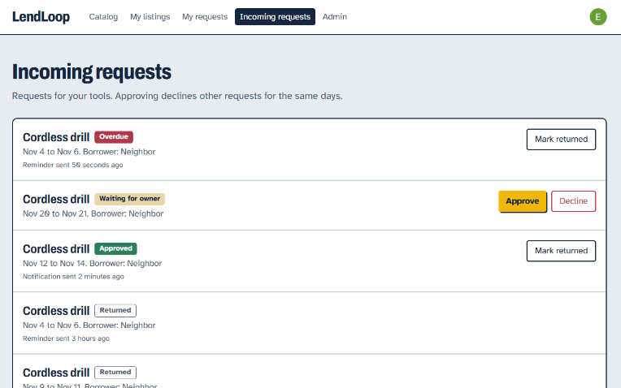
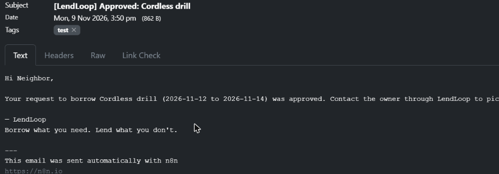
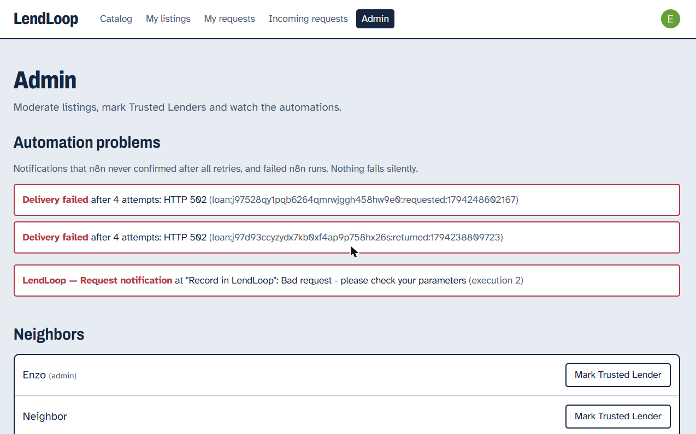
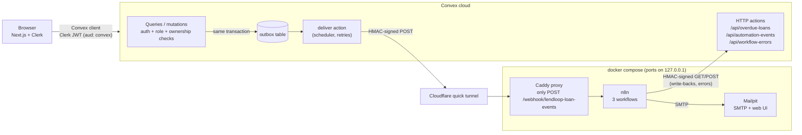

# LendLoop

**Borrow what you need. Lend what you don't.**

A neighborhood tool-lending board. Neighbors list tools, ask to borrow them for a date range, owners
approve or decline, and loans are marked returned. Two n8n workflows send the emails: a notification on
every loan change, and a daily reminder for overdue loans. Every loan shows its latest automation
activity, for example *"Reminder sent 2 days ago"*.

Stack: Next.js 16 (App Router) · TypeScript · Tailwind 4 · Clerk · Convex · n8n 2.46 (Docker) · Mailpit.



| Mailpit: notification email | Admin: automation problems |
|---|---|
|  |  |

## Contents

- [Features](#features)
- [Quick start](#quick-start)
- [Environment variables](#environment-variables)
- [Architecture](#architecture)
- [Security decisions](#security-decisions)
- [Data minimization](#data-minimization)
- [Standards framing](#standards-framing)
- [Testing](#testing)
- [What I'd change in production](#what-id-change-in-production)

## Features

| Page | Who | What |
|---|---|---|
| `/` | everyone | Tagline, available tools (name + category only), "Sign in to lend or borrow" |
| `/tools` | signed in | Catalog, availability badge, category filter, request form with dates |
| `/my/listings` | signed in | Create, edit and remove your tools |
| `/my/requests` | signed in | Your borrow requests; cancel while pending |
| `/my/incoming` | signed in | Requests for your tools: approve, decline, mark returned |
| `/admin` | admin | All loans, remove any listing, Trusted Lender badge, failed deliveries and failed n8n runs |

Loan states: `requested → approved → returned`, or `requested → declined | cancelled`. Approving a loan
auto-declines other pending requests for overlapping days. A loan is **overdue** from the day after its
end date (UTC).

## Quick start

You need: Node 24, pnpm 10, Docker Desktop, Git Bash (on Windows), and free accounts on
[Clerk](https://clerk.com) and [Convex](https://convex.dev). No paid service is used.

### 1. Install

```bash
pnpm install
cp .env.example .env.local
```

### 2. Convex

```bash
npx convex dev
```

The first run logs you in, creates a dev deployment and writes `CONVEX_DEPLOYMENT` and
`NEXT_PUBLIC_CONVEX_URL` into `.env.local`. Keep it running: it pushes the `convex/` functions on every
save. (It will fail to push until step 3 sets `CLERK_JWT_ISSUER_DOMAIN`. That is expected.)

### 3. Clerk

1. Create an application in the Clerk dashboard (email sign-in is enough).
2. Copy the API keys into `.env.local`: `NEXT_PUBLIC_CLERK_PUBLISHABLE_KEY`, `CLERK_SECRET_KEY`.
3. Activate the **Convex integration** (Clerk dashboard → Integrations → Convex). Session tokens then
   have `aud: "convex"`. Copy the **Frontend API URL** it shows.
4. **Customize the session token** (Sessions → Customize session token). The app needs these claims, and
   nothing more:

   ```json
   {
     "email": "{{user.primary_email_address}}",
     "email_verified": "{{user.email_verified}}",
     "name": "{{user.full_name}}",
     "given_name": "{{user.first_name}}"
   }
   ```

   `email_verified` matters: only a **verified** email can be admin.
5. Set the Convex env vars:

   ```bash
   npx convex env set CLERK_JWT_ISSUER_DOMAIN https://<your-app>.clerk.accounts.dev
   npx convex env set ADMIN_EMAILS you@example.com
   ```

   `ADMIN_EMAILS` is a comma-separated list. The role is computed on every request, so removing an email
   removes admin access immediately.

### 4. Run the app

```bash
pnpm dev
```

Open http://localhost:3000 and sign in. To try the full flow you need **two** accounts (one owner, one
borrower), for example two browser profiles.

### 5. n8n + Mailpit (Docker)

One time only — creates the shared secrets. It writes `n8n/.env` (gitignored) and sets the same two
secrets in Convex through stdin. It never prints them:

```bash
bash scripts/setup-local-secrets.sh
```

Start the stack and import the workflows (this also imports the Mailpit SMTP credential, which has no
secret):

```bash
docker compose up -d
bash scripts/n8n-import.sh
```

- n8n: http://localhost:5678 (first visit asks you to create the local owner account; the workflows run
  without it)
- Mailpit (all emails land here): http://localhost:8025

### 6. Tunnel (every session)

Convex runs in the cloud, so it cannot reach `localhost`. A free Cloudflare quick tunnel (no account)
exposes **only** the webhook path:

```bash
bash scripts/tunnel.sh
```

It starts the tunnel container, reads the new `https://<random>.trycloudflare.com` URL and sets
`N8N_WEBHOOK_URL` in Convex. The URL changes each time the tunnel restarts, so run it again after a
restart.

### 7. Try the overdue reminder

```bash
npx convex env set ALLOW_DEV_TOOLS true
npx convex run dev:seedOverdueLoan '{"fromLoanId":"<an existing loan id>","daysOverdue":3}'
npx convex env remove ALLOW_DEV_TOOLS
bash scripts/n8n-run-overdue.sh
```

The script runs the reminder workflow now (normally daily at 09:00 UTC). Check Mailpit, then
`/my/requests` shows "Reminder sent …". Run it again: no second email, because the write-back key
`reminder:{loanId}:{date}` already exists.

### Manual E2E checklist

Sign in (owner) → list a tool → sign in (borrower) → request it → owner approves → email in Mailpit →
seed an overdue loan → run reminders → "Reminder sent …" in the app → run again, no duplicate →
`docker compose stop n8n` → make a loan change → after the retries the delivery is listed as failed in
`/admin` (`npx convex run outbox:deliver '{"outboxId":"..."}'` forces the next attempt without waiting).

## Environment variables

| Variable | Where it lives | Secret? | Purpose |
|---|---|---|---|
| `CONVEX_DEPLOYMENT` | `.env.local` (Next) | no | Written by `npx convex dev` |
| `NEXT_PUBLIC_CONVEX_URL` | `.env.local` (Next) | no | Convex client URL; also used by the CSP |
| `NEXT_PUBLIC_CLERK_PUBLISHABLE_KEY` | `.env.local` (Next) | no | Clerk frontend key; the CSP reads the Clerk host from it |
| `CLERK_SECRET_KEY` | `.env.local` (Next) | **yes** | Clerk server key |
| `CLERK_JWT_ISSUER_DOMAIN` | Convex env | no | Which Clerk issuer Convex trusts |
| `ADMIN_EMAILS` | Convex env | no | Comma-separated admin emails (must be verified) |
| `N8N_WEBHOOK_URL` | Convex env | no | Tunnel URL + `/webhook/lendloop-loan-events`; set by `tunnel.sh` |
| `LENDLOOP_TO_N8N_SECRET` | Convex env **and** `n8n/.env` | **yes** | Convex signs, n8n verifies |
| `N8N_TO_LENDLOOP_SECRET` | Convex env **and** `n8n/.env` | **yes** | n8n signs, Convex verifies |
| `ALLOW_DEV_TOOLS` | Convex env (temporary) | no | Enables `dev:seedOverdueLoan`; remove after the demo |
| `CONVEX_SITE_URL` | `n8n/.env` | no | Base URL of the Convex HTTP actions (`*.convex.site`) |
| `OPS_EMAIL` | `n8n/.env` | no | Where the error workflow sends alerts |
| `N8N_ENCRYPTION_KEY` | `n8n/.env` | **yes** | Encrypts n8n credentials at rest |

Examples without values: [`.env.example`](.env.example), [`n8n/.env.example`](n8n/.env.example).
`pnpm check:secrets` fails if anything that looks like a secret (or any value from the local env files)
is in a file git would commit. Run it before every commit; CI runs it too.

## Architecture



### Flow of one notification

1. A mutation changes a loan (e.g. `approve`) and, **in the same transaction**, inserts an `outbox` row
   and schedules `outbox.deliver`. If the mutation fails, neither the change nor the row exists.
2. `deliver` signs the JSON payload and POSTs it to n8n (10 s timeout). On a non-2xx answer or a
   network error it retries after 1, 5 and 30 minutes. After 4 attempts the row is `failed` and
   `/admin` lists it with `lastError`.
3. n8n verifies the HMAC over the raw body, sends the email, writes back a signed
   `request_notification_sent` event (key `notify:{eventId}`), and only then answers 200. So Convex marks
   the row `sent` only when the email went out and was recorded.

### Workflows (`n8n/workflows/`)

| Workflow | Trigger | Steps |
|---|---|---|
| Request notification | Webhook (raw body) | verify HMAC → 401 if bad → compose plain-text email → send (Mailpit) → signed write-back → respond 200 |
| Overdue reminders | Daily 09:00 UTC | signed `GET /api/overdue-loans` → one email per loan → signed write-back `reminder:{loanId}:{date}` |
| Error handler | Error workflow of the two above | record in Convex (`/api/workflow-errors`, shown in `/admin`) → email ops; each step continues on error, so either one still alerts |

HTTP Request and Send Email nodes retry 3 times. The exported JSON contains no credentials and no secret
values: n8n reads the secrets from its environment.

### Data model (Convex)

| Table | Key fields |
|---|---|
| `users` | `tokenIdentifier` (from Clerk), `email` (server only), `name`, `role` (display cache), `trustedLender` |
| `tools` | `ownerId`, `name` ≤ 80, `category`, `condition`, `description` ≤ 500, `deletedAt` (soft delete) |
| `loans` | `toolId`, `borrowerId`, `ownerId`, `startDate`, `endDate` (`YYYY-MM-DD`, UTC), `status`, `updatedAt` |
| `outbox` | `eventId`, `payload`, `status` (pending/sent/failed), `attempts`, `lastError`, `nextAttemptAt` |
| `automationEvents` | `idempotencyKey` (unique), `loanId`, `kind`, `createdAt` |
| `workflowErrors` | `idempotencyKey` (`error:{executionId}`), `workflowName`, `nodeName`, `message` |

## Security decisions

- **Authorization lives in Convex.** Every public function derives the user from the verified JWT and
  checks role and ownership on the server (`requireUser`, `requireAdmin`). Hiding links in the UI is only
  cosmetic. The full list of functions and their guards is in
  [`docs/security-review.md`](docs/security-review.md).
- **Admin = verified email in `ADMIN_EMAILS`**, recomputed on every request. Without the verified check,
  anyone could sign up with the admin's address.
- **HMAC-SHA256 in both directions.** Headers `X-LendLoop-Timestamp` (unix seconds) and
  `X-LendLoop-Signature` (hex). Signed string: `` `${timestamp}.${METHOD}.${path}.${rawBody}` ``.
  The receiver hashes the **raw** body (re-serialized JSON can change spaces and break the signature) and
  compares in constant time. Test vector (also checked in `convex/lib/hmac.test.ts`):

  | secret | signed string | signature |
  |---|---|---|
  | `s3cret` | `1700000000.POST./api/x.{}` | `a7a5eb0d86209484fa6b1524199f9fb7ffcfee26aae250c4ca68fe2cb1243582` |

- **Replay window: 300 s.** Older or future timestamps get 401. Inside the window, write-backs are
  idempotent (same key → `200 {duplicate: true}`, no new row).
- **Two secrets, one per direction.** A leak on one side does not let an attacker sign in the other
  direction, and each can be rotated alone (`setup-local-secrets.sh --force`).
- **Idempotency keys:** `notify:{eventId}` (eventId = `loan:{loanId}:{status}:{updatedAt}`),
  `reminder:{loanId}:{YYYY-MM-DD}`, `error:{executionId}`. A write-back key must belong to its own loan.
- **Email delivery is at-least-once.** n8n answers 200 only after the email and the write-back. If the
  write-back keeps failing (for example Convex is down), n8n answers 500, Convex retries, and the
  same email can be sent up to 4 times (one per delivery attempt). The production fix is below.
- **No silent failures.** Failed deliveries (after retries) and failed n8n runs are stored and shown in
  `/admin`. Bad config (no URL or secret) fails at once instead of retrying.
- **HTTP endpoints:** body > 16 KB → 413 (before the HMAC work), bad signature → 401 with no detail,
  bad JSON shape → 400. Bodies are parsed as `unknown` and checked field by field.
- **Small attack surface for n8n.** All compose ports are bound to `127.0.0.1`. The tunnel points at a
  Caddy proxy that forwards only `POST /webhook/lendloop-loan-events`; the n8n editor and API return 404
  from the internet.
- **Abuse limits:** ≤ 50 tools per user, ≤ 10 pending requests per borrower, ≤ 20 new requests per
  borrower per 24 h (stops a request/cancel loop from flooding an owner with emails), length limits on
  every text field.
- **Security headers** (`next.config.ts`, `lib/securityHeaders.ts`): a CSP whose network and script
  sources are this site, the exact Clerk host (read from the publishable key), the exact Convex host
  (HTTPS + WebSocket), plus what Clerk needs (`img.clerk.com`, `clerk-telemetry.com`, Cloudflare
  Turnstile). Scripts still allow `'unsafe-inline'` (Next.js inline bootstrap; see production plans).
  `X-Frame-Options: DENY`, `frame-ancestors 'none'`, `nosniff`, `strict-origin-when-cross-origin`,
  `Permissions-Policy` with camera, microphone and location off.
- **Supply chain:** exact versions in `package.json` (`save-exact`), committed lockfile, CI with `pnpm audit
  --audit-level=high`, GitHub Actions pinned to commit SHAs with read-only permissions, Dependabot for npm,
  Docker images and actions. Docker images pinned by tag.
- **Self-review:** [`docs/security-review.md`](docs/security-review.md). It is a self-review, **not a
  professional audit or pentest**.

## Data minimization

- **Public page:** `tools.listPublic` returns only `{ name, category }` of available tools. No owner, no
  id, no description.
- **Browser:** emails are never sent to the browser. Other users appear by first name only. Admin views
  show names, not emails, and never the outbox payload.
- **n8n payloads:** only what the email needs — `eventId`, `loanId`, `event`, recipient
  `{ email, name }`, `toolName`, `startDate`, `endDate`. The overdue list sends only the borrower's email
  and name, tool name, end date and days overdue. No descriptions, no owner contact data, no other user's
  data.
- **Clerk token:** only four extra claims (`email`, `email_verified`, `name`, `given_name`).

## Standards framing

The decisions above are **aligned with** the intent of common control areas. This project is not
certified or compliant with any standard; ISO/IEC 27001 and SOC 2 certify organizations, not apps.

| Control area (OWASP ASVS / ISO/IEC 27001 Annex A themes) | Where in LendLoop |
|---|---|
| Access control | Server-side checks in every Convex function; least-privilege CI token |
| Cryptography | HMAC-SHA256, constant-time compare, separate secrets per direction |
| Secrets management | Env vars only, gitignored files, secret scan in CI, no secrets in workflow JSON |
| Logging and monitoring | Failed deliveries and workflow errors visible in `/admin`; rejected calls logged |
| Data minimization | Public page and n8n payload fields above |
| Secure development | Tests, typecheck, lint, audit and secret scan in CI; Dependabot |

## Testing

```bash
pnpm typecheck && pnpm lint && pnpm test && pnpm check:secrets
```

- Vitest + `convex-test`: roles and ownership, the loan state machine, overlap rules, limits, outbox
  retries, signed HTTP endpoints, idempotent write-backs, overdue selection, `lastActivity`.
- Pure unit tests: HMAC (valid, changed body, wrong secret, stale timestamp, whitespace change), dates
  (end date = today is not overdue), payloads, security headers.
- Manual E2E: the checklist in the Quick start.

## What I'd change in production

These are plans, not things this project does today.

- **Secrets:** a managed secret store (for example AWS Secrets Manager) with scheduled key rotation,
  instead of env files.
- **n8n hosting:** a managed n8n or a container service (for example AWS ECS/Fargate) behind a fixed
  domain with TLS, instead of a quick tunnel; n8n in queue mode with Postgres.
- **Delivery:** a durable queue for the outbox, and n8n checking `notify:{eventId}` before sending, for
  exactly-once emails.
- **Replay:** a nonce store (remember each signature for the 5-minute window) for strict replay
  protection.
- **Email:** a real provider (Amazon SES or Resend) with SPF/DKIM, by changing the SMTP credential.
- **Monitoring:** Sentry for errors and Datadog (or similar) for logs, metrics and alerts on failed
  deliveries.
- **Rate limiting:** `@convex-dev/rate-limiter` per user and an edge rate limit for public pages.
- **CSP:** a nonce-based policy without `'unsafe-inline'`.
- **If the data were health data (HIPAA-style controls):** encryption at rest with managed keys, an
  immutable audit log of every access and change, BAAs with every vendor that touches the data, a data
  retention and deletion policy, and minimum-necessary access reviews.
- **Assurance:** an external security review and penetration test before launch.
